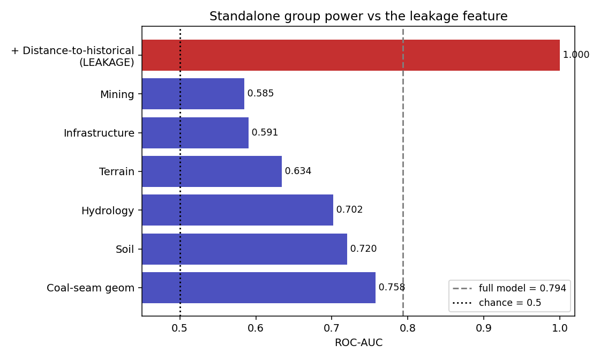
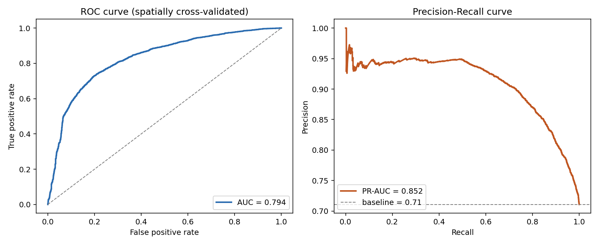
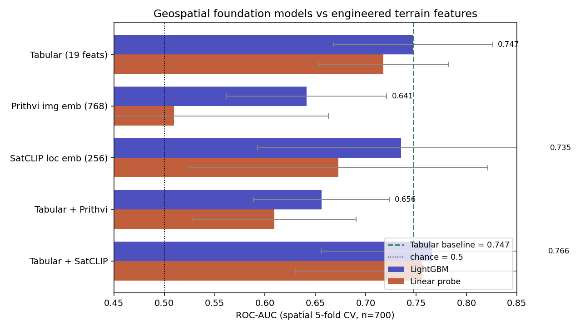
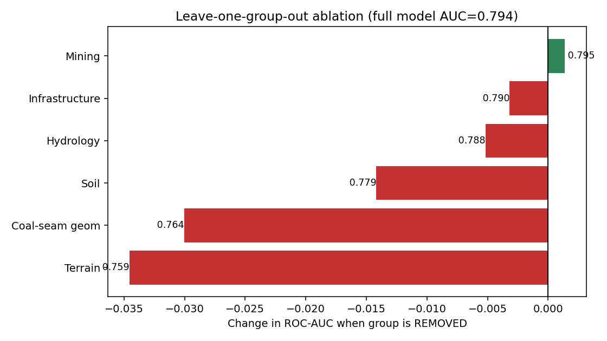
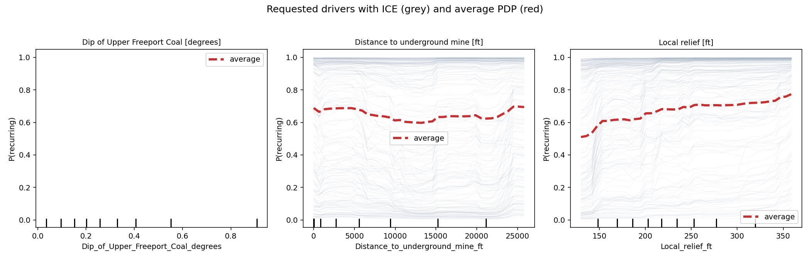
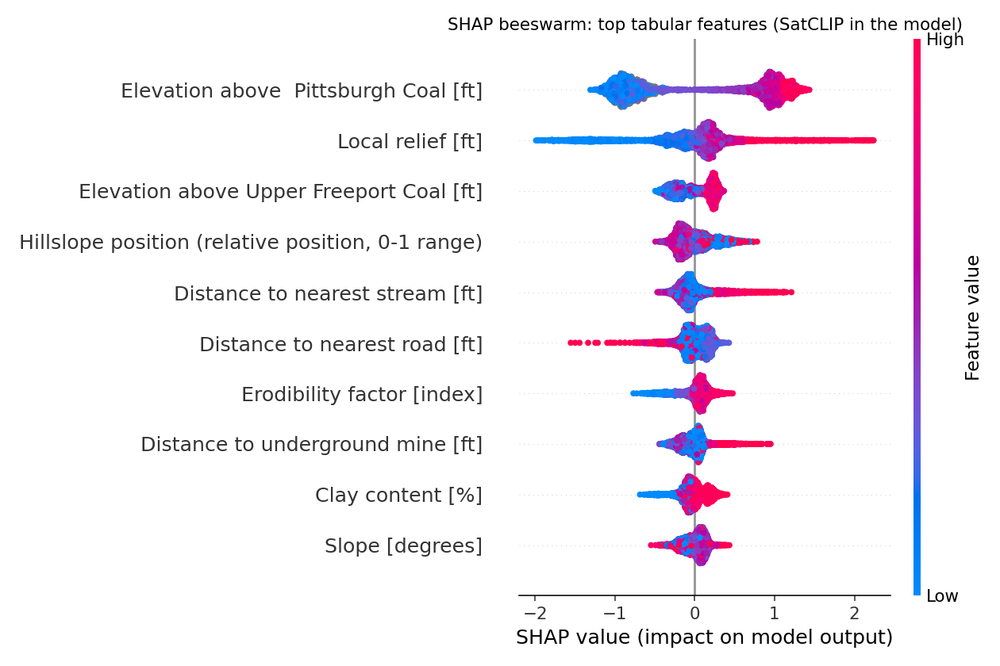
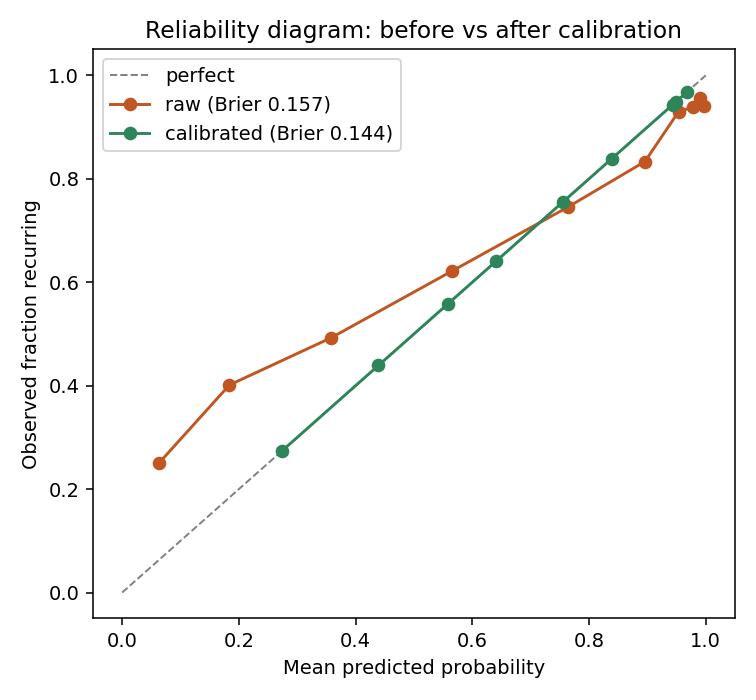

## Abstract

Distinguishing reactivated (recurring) landslides from first-time (new) failures is central to hazard mitigation, yet the machine-learning practice underpinning such maps is vulnerable to two silent failures: information leakage from inventory-derived covariates, and spatial autocorrelation that inflates cross-validated skill. We assemble an inventory of 6,129 mapped slides in an undermined coalfield of southwestern Pennsylvania, USA, and use it to (i) demonstrate and remove definitional leakage, (ii) establish an honest, spatially cross-validated and probability-calibrated gradient-boosted baseline, and (iii) benchmark three state-of-the-art foundation models against engineered terrain covariates: a tabular foundation model (TabPFN v2), an imagery geospatial foundation model (Prithvi-EO-1.0-100M applied to Sentinel-2 chips), and a location geospatial foundation model (SatCLIP). A single inventory covariate, distance to historical slides, produces a perfect classifier (ROC-AUC = 1.000) because it encodes the label definition; after its removal, honest spatial cross-validation yields ROC-AUC = 0.794. TabPFN v2 matches the tuned baseline with zero tuning (0.779). The imagery foundation model underperforms and degrades the model when fused (0.641 alone; 0.656 fused versus 0.747 tabular on a common subsample), while SatCLIP location embeddings add a small, well-calibrated gain (full-data ROC-AUC 0.808; Brier 0.159 to 0.132) that SHAP attribution shows to be diffuse and spatial rather than physical. Across every configuration, engineered coal-seam and terrain covariates (elevation above the Pittsburgh and Upper Freeport coals, local relief, hillslope position) remain the dominant predictors. We conclude that off-the-shelf, frozen foundation models are promising but do not yet outperform domain covariates for landslide reactivation, and we argue that leakage auditing and spatial validation should be reporting standards for the field.

**Keywords:** landslide reactivation; foundation models; spatial cross-validation; data leakage; probability calibration; underground mining; SHAP

## 1. Introduction

Landslide susceptibility mapping has been transformed by machine learning, with tree ensembles and neural networks now standard tools for translating terrain and geological covariates into spatial estimates of failure likelihood [@reichenbach2018; @merghadi2020]. A less studied but operationally important variant of the problem is the discrimination of *reactivated* failures, slides that recur on ground that has moved before, from *new*, first-time failures. Reactivation is governed by the persistence of weak, previously displaced material and by anthropogenic disturbance of the subsurface, and it concentrates hazard in ways that first-time susceptibility maps do not capture.

Two methodological hazards threaten the credibility of such models, and both are easy to overlook. The first is *information leakage*: covariates derived from the same inventory that defines the target can encode the label almost perfectly, yielding models that appear excellent but generalize nowhere. In reactivation mapping the canonical offender is proximity to previously mapped slides, which is close to a restatement of the definition of "recurring." The second is *spatial autocorrelation*: because nearby points share terrain, geology and disturbance history, a random train and test partition places near-neighbors on both sides of the split and reports optimistic skill that collapses at genuinely new locations. The ecological and geospatial literature has repeatedly shown that spatial or block cross-validation is required for honest error estimates [@roberts2017; @ploton2020], yet random splits remain common in applied landslide studies.

In parallel, the arrival of *foundation models*, large models pretrained on broad data and adapted to downstream tasks with little or no fine-tuning, has raised the question of whether they can supersede hand-engineered covariates in the earth sciences. Three families are directly relevant here. Tabular foundation models such as TabPFN perform in-context learning over tabular data and have reported strong small-data performance [@hollmann2025]. Imagery geospatial foundation models such as Prithvi-EO and Clay are pretrained by masked reconstruction of multispectral satellite time series and produce transferable image embeddings [@jakubik2023]. Location foundation models such as SatCLIP learn general-purpose embeddings of geographic coordinates by contrastive alignment with satellite imagery [@klemmer2023]. Each promises to inject globally learned context that a local covariate set might miss. Whether that promise materializes for a fine-grained, physically driven task such as landslide reactivation is an open and practically consequential question.

Here we address these three issues jointly. Using a 6,129-point inventory from an undermined Appalachian coalfield, we first quantify the magnitude of definitional leakage, then build a leakage-free, spatially cross-validated and calibrated gradient-boosted baseline, and finally benchmark TabPFN v2, Prithvi-EO and SatCLIP against the engineered covariates under an identical spatial-validation protocol. Our contribution is threefold: a demonstration of how severely leakage and spatial autocorrelation distort reactivation models; a rigorous, calibrated baseline with interpretable drivers; and, to our knowledge, the first head-to-head evaluation of tabular and geospatial foundation models for landslide reactivation, with an honest negative result that we believe is valuable for the field.

## 2. Study area and data

The study area lies in southwestern Pennsylvania, USA, within the bituminous Appalachian coalfield, where more than a century of underground coal extraction has removed support from overburden above the Pittsburgh and Upper Freeport coal seams. The inventory comprises 6,129 mapped slide points compiled from federal (United States Geological Survey) and municipal and zone-level surveys, spanning roughly 108 km east to west and 138 km north to south. Each point is labeled as recurring (reactivated; n = 4,357, 71%) or new (first-time; n = 1,772, 29%).

Each point carries 25 attributes. Beyond identifiers and coordinates, these comprise topographic derivatives (slope, aspect, mean curvature, hillslope position, local relief), hydrological descriptors (topographic wetness index, distance to nearest stream, upslope drainage area, saturated hydraulic conductivity, drainage class), soil properties (clay content, erodibility factor), an infrastructure descriptor (distance to nearest road), and, distinctively for this coalfield, a suite of coal-seam and mining covariates: distance and depth to underground mine, elevation above the Pittsburgh and Upper Freeport coals, and the aspect and dip of the Upper Freeport coal. Missingness is heterogeneous: depth to underground mine is 71% missing and elevation above the Pittsburgh coal 38% missing, while most terrain covariates are essentially complete. Table 1 summarizes the covariate groups.

**Table 1.** Covariate groups used in modeling (19 features after leakage removal).

| Group | Covariates |
|---|---|
| Terrain | slope, aspect, mean curvature, hillslope position, local relief |
| Hydrology | wetness index, distance to stream, drainage area, saturated hydraulic conductivity, drainage class |
| Soil | clay content, erodibility factor |
| Infrastructure | distance to nearest road |
| Coal-seam / mining | distance to mine, depth to mine, elevation above Pittsburgh coal, elevation above Upper Freeport coal, aspect of Upper Freeport coal, dip of Upper Freeport coal |

## 3. Methods

### 3.1 Problem formulation and leakage control

We formulate reactivation mapping as binary classification (recurring = 1, new = 0). Before any modeling we removed four attributes as leakage or labeling artifacts: distance to historical slides (a near-restatement of the label; see Section 4.1), data source (an inventory-provenance proxy: USGS-sourced points are 81% recurring), zone number (an administrative and spatial proxy: one zone is 89% recurring), and the row identifier. Longitude and latitude were withheld as predictive features and reserved solely for constructing location embeddings and spatial validation folds. This leaves 19 physically interpretable covariates.

### 3.2 Spatial cross-validation

To obtain honest generalization estimates we used spatial block cross-validation. Point coordinates were clustered into twelve geographic blocks by k-means, and stratified group five-fold cross-validation held out whole blocks at a time, so that no test point shared a block with any training point [@roberts2017]. All reported skill metrics are means over these spatial folds. Because coordinates are excluded from the feature set, models cannot trivially memorize location.

### 3.3 Gradient-boosted baseline and calibration

The baseline classifier was a gradient-boosted decision tree ensemble (LightGBM [@ke2017]), chosen for its native handling of missing values and its interpretability. Class imbalance was addressed through instance weighting. Because imbalance weighting sharpens ranking but distorts predicted probabilities, we calibrated the model with isotonic regression fit on spatial out-of-fold scores [@zadrozny2002], and selected the decision threshold by maximizing the out-of-fold F1 score. We report ROC-AUC and precision-recall AUC for discrimination and the Brier score for calibration.

### 3.4 State-of-the-art foundation models

We benchmarked three foundation models under the identical spatial-validation protocol.

*Tabular foundation model.* TabPFN v2 [@hollmann2025], a pretrained transformer that performs in-context learning over tabular data with no gradient training, was applied directly to the 19 covariates.

*Imagery geospatial foundation model.* For each point we retrieved a cloud-minimized Sentinel-2 Level-2A image chip (bands B02, B03, B04, B8A, B11, B12, mapped to the six harmonized-Landsat-Sentinel bands expected by the model) from a public cloud archive, centered on the point and covering 2.24 km. Chips were normalized with the model's pretraining statistics and passed through the frozen Prithvi-EO-1.0-100M encoder [@jakubik2023]; patch tokens were mean-pooled to a 768-dimensional embedding. Because image retrieval is comparatively expensive, the imagery benchmark used a stratified spatial subsample of 700 points; tabular and location models were evaluated both on the full inventory and on this common subsample for a fair comparison.

*Location geospatial foundation model.* SatCLIP [@klemmer2023] maps coordinates to a 256-dimensional embedding pretrained by contrastive alignment with Sentinel-2 imagery worldwide. We embedded every point from its coordinates alone.

Each representation (tabular, each embedding, and tabular-plus-embedding fusions) was scored on the same spatial folds with both a regularized linear probe (the standard evaluation for frozen embeddings) and LightGBM.

### 3.5 Interpretation

We characterized drivers three ways. Group ablation removed one covariate group at a time and measured the change in spatial AUC, and separately trained on each group alone to quantify standalone signal. Partial-dependence and individual-conditional-expectation curves described the marginal direction of each leading driver. Finally, SHAP values [@lundberg2017] computed on the fused tabular-plus-SatCLIP model quantified, at the level of individual features, whether tabular covariates retain their dominance once location embeddings are present.

## 4. Results

### 4.1 Definitional leakage is severe

Distance to historical slides almost perfectly separates the classes: recurring points lie a median 51 ft from a mapped historical slide (maximum 982 ft), whereas new points lie a median 2,325 ft away (minimum 937 ft), so the two distributions barely overlap. Adding this single covariate to the leakage-free feature set raises spatial cross-validated ROC-AUC from 0.794 to 1.000. This is not predictive skill but a circular restatement of how the label is defined, and it motivates the strict exclusion policy of Section 3.1. Figure 1 places this leakage feature alongside the standalone power of each legitimate covariate group.

### 4.2 Predictive performance and the foundation-model benchmark

On the full inventory, the leakage-free baseline achieved spatially cross-validated ROC-AUC 0.794 (standard deviation 0.093 across folds) and precision-recall AUC 0.852 (Figure 2). Fold AUC ranged from 0.65 to 0.93, reflecting genuine spatial heterogeneity in predictability rather than noise. TabPFN v2 reached 0.779 with no tuning, statistically indistinguishable from the tuned baseline and a testament to the maturity of tabular foundation models, though not an improvement.

The geospatial foundation models tell a more cautionary story (Table 2, Figure 3). On the common 700-point subsample, the engineered covariates scored 0.747; the frozen Prithvi imagery embeddings scored only 0.641 with LightGBM and near chance (0.509) with a linear probe, and fusing them with the covariates *reduced* performance to 0.656. SatCLIP location embeddings scored 0.735 alone and produced a small gain when fused (0.766). On the full inventory the fusion of covariates and SatCLIP reached ROC-AUC 0.808 (standard deviation 0.083), a marginal improvement of 0.014 over the covariate-only baseline, accompanied by a clear calibration benefit (Section 4.4).

**Table 2.** Spatially cross-validated ROC-AUC by representation and classifier. Imagery rows and the common-subsample columns use the 700-point stratified subsample; full-inventory results use all 6,129 points.

| Representation | Linear probe | LightGBM |
|---|---|---|
| Tabular, 19 covariates (subsample) | 0.718 | 0.747 |
| Prithvi imagery embedding, 768-d | 0.509 | 0.641 |
| SatCLIP location embedding, 256-d | 0.673 | 0.735 |
| Tabular + Prithvi | 0.609 | 0.656 |
| Tabular + SatCLIP (subsample) | 0.756 | 0.766 |
| Tabular only (full inventory) | — | 0.794 |
| TabPFN v2 (full inventory) | — | 0.779 |
| Tabular + SatCLIP (full inventory) | — | 0.808 |

### 4.3 Drivers of reactivation

Ablation identified terrain and coal-seam geometry as the load-bearing covariate groups: removing terrain cost 0.035 AUC and removing coal-seam geometry 0.030, whereas removing the mining group changed AUC negligibly because its information is redundant with the coal-seam and terrain covariates that describe the same undermined ground (Figure 4). Standalone, coal-seam geometry alone reached 0.758, nearly matching the full model, while mining alone still exceeded chance at 0.585. No single group approached the full model, indicating genuinely multivariate skill.

Partial-dependence analysis gave physically coherent directions: reactivation probability rose with local relief (change of +0.142 across the interdecile range) and with elevation above the Upper Freeport coal (+0.118), and fell with distance to underground mine (-0.065), so that risk peaks on high-relief slopes situated well above the coal seams and close to old workings (Figure 5). SHAP attribution on the fused tabular-plus-SatCLIP model confirmed that the single strongest predictor in the entire 275-feature model is a tabular one, elevation above the Pittsburgh coal (mean absolute SHAP 0.895), roughly fifty times the average SatCLIP dimension; local relief, elevation above the Upper Freeport coal, hillslope position and distance to stream follow (Figure 6). The SatCLIP block carries substantial *aggregate* importance but only because it is spread thinly across 256 dimensions, consistent with a smooth encoding of geographic position rather than a sharp physical driver.

### 4.4 Calibration

Isotonic calibration improved the Brier score of the baseline from 0.157 to 0.144 and of the fused tabular-plus-SatCLIP model from 0.159 to 0.132, moving the operating threshold to a natural value near 0.4 and producing reliability curves that closely track the diagonal (Figure 7). Calibration is essential if the output is to be read as an actual reactivation probability for triage.

## 5. Discussion

Three findings stand out. First, definitional leakage in reactivation inventories is not a subtle bias but a catastrophic one: a single covariate manufactured a flawless classifier that would have collapsed in deployment. Reactivation studies that include proximity-to-past-slide covariates, or that do not audit their features against the label definition, risk reporting skill that does not exist. Second, spatial autocorrelation and honest validation matter: our fold AUCs varied by nearly 0.3, and a random split would have averaged away that heterogeneity into a falsely reassuring number. Third, and most novel, off-the-shelf foundation models did not beat engineered covariates for this task, and the imagery model actively harmed the fused model.

The imagery result is interpretable rather than surprising. Prithvi-EO is pretrained to reconstruct multispectral surface reflectance, so its frozen embeddings encode land cover, vegetation and spectral texture, whereas landslide reactivation is driven by slope, subsurface coal-seam geometry and legacy mining, factors largely invisible in a single summer optical scene. A digital-elevation-model foundation model, or fine-tuning rather than frozen feature extraction, would be a more promising route and is a clear direction for future work. The SatCLIP result is subtler: its small, well-calibrated gain is attributable to residual spatial context, precisely the location information we deliberately excluded from the covariate set to prevent spatial memorization. Interpreted honestly, SatCLIP reintroduces a controlled amount of "where," useful for calibration but not a new physical mechanism, as the SHAP attribution makes explicit.

That TabPFN v2 matched a tuned gradient-boosted ensemble with no tuning is a practically useful result: tabular foundation models are now a credible, zero-configuration second opinion for inventories of this size, even where they do not improve on the state of the art. Taken together, the results support a measured view of foundation models in geohazards: they are maturing rapidly and are worth benchmarking, but for fine-grained, physically driven prediction they complement rather than replace carefully engineered, domain-specific covariates.

## 6. Limitations

Several limitations qualify these conclusions. The reactivation label is partly tied to inventory provenance, and although we removed the data-source covariate, any systematic mapping bias in the underlying surveys could persist. Depth to underground mine is 71% missing, so the mining signal is thin and should not be over-interpreted. This is a susceptibility model conditioned on static attributes, not a temporal forecast, and it cannot predict the timing of movement. The imagery benchmark used frozen embeddings from single-date optical chips resampled into the model's native resolution and a 700-point subsample; multi-date stacks, higher-resolution or elevation-based foundation models, and end-to-end fine-tuning could all change the imagery result. Finally, spatially cross-validated AUC near 0.8 is the honest cross-region estimate; transfer to an entirely new county may be lower and should be validated with local data.

## 7. Conclusions

Using a 6,129-point inventory from an undermined Appalachian coalfield, we showed that a single inventory-derived covariate produces a spuriously perfect reactivation classifier, established a leakage-free, spatially cross-validated and calibrated baseline (ROC-AUC 0.794), and benchmarked three state-of-the-art foundation models against engineered covariates under an identical protocol. A tabular foundation model matched the baseline without tuning; an imagery geospatial foundation model underperformed and degraded the fused model; and a location foundation model added only a small, spatially attributable and well-calibrated gain (0.808). Across all configurations the recurrence signal remained in engineered coal-seam and terrain covariates. We recommend that leakage auditing and spatial cross-validation be treated as reporting standards for landslide reactivation modeling, and that foundation models be adopted where they demonstrably help rather than by assumption.

## Data and code availability

The analysis code (data preparation, spatial cross-validation, calibration, foundation-model benchmarking, and interpretation) and derived figures are available from the authors. The inventory may be subject to source-agency terms.

## Author contributions

[To be completed.]

## Acknowledgements

[To be completed.]

## References
