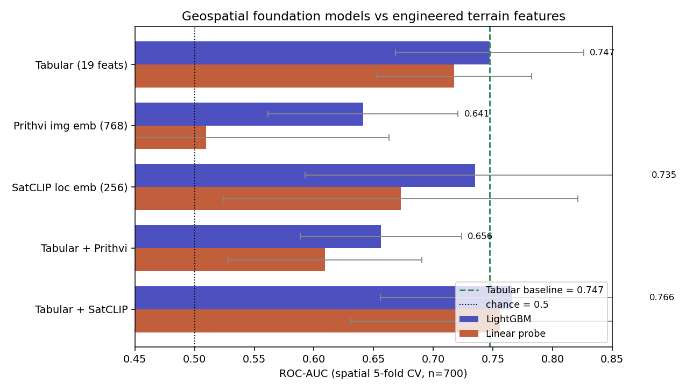
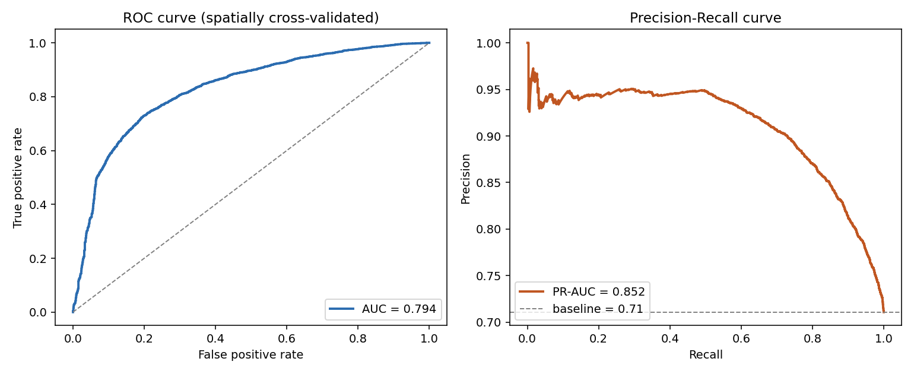
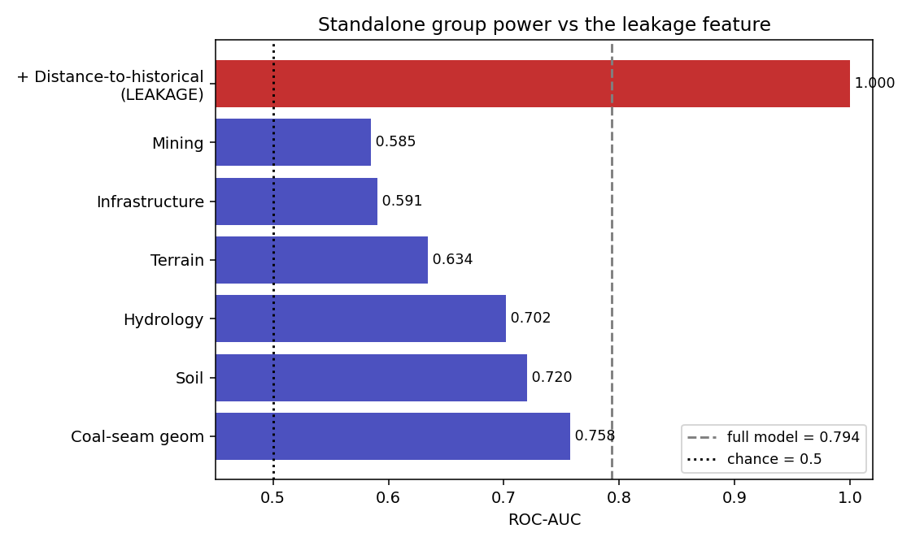
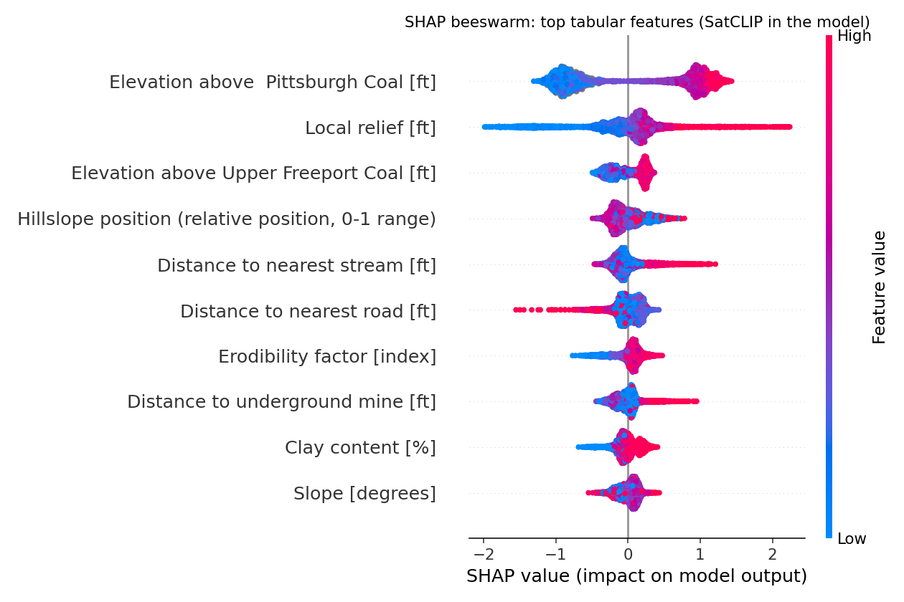
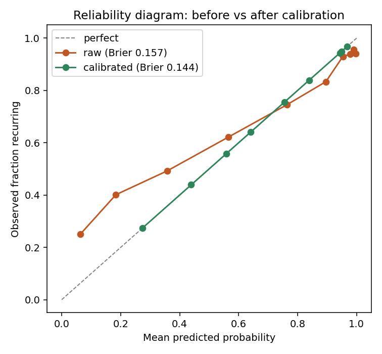

# Landslide Reactivation: Foundation Models vs Engineered Terrain

> A leakage-aware, spatially cross-validated benchmark of state-of-the-art
> tabular and geospatial foundation models (**TabPFN v2**, **Prithvi-EO**,
> **SatCLIP**) against engineered terrain covariates for predicting landslide
> **recurrence** in an undermined Appalachian coalfield (6,129 mapped slides,
> SW Pennsylvania).

Predicts whether a slope location is a **recurring** slide (on/near a past
failure) versus a **new** slide, from physical and geologic conditions.
The headline finding: after removing definitional leakage and validating across
space, off-the-shelf foundation models do **not** beat engineered terrain
covariates, and the engineered coal-seam and terrain features remain the
dominant predictors.

## Highlights

**Foundation models vs engineered covariates** (same points, same spatial folds)



**Honest performance, and the leakage demonstration** (reintroducing one
inventory covariate drives AUC to a meaningless 1.000)

<p>
  
  
</p>

**What drives reactivation** (SHAP, with SatCLIP in the model) and **calibrated probabilities**

<p>
  
  
</p>

## Files
| File | Purpose |
|------|---------|
| `train.py` | Trains the model, runs spatial cross-validation, saves the artifact. |
| `predict.py` | Scores a CSV of new locations. |
| `landslide_recurrence_model.joblib` | Trained LightGBM model + threshold + feature map. |
| `metrics.json` | Cross-validated performance. |
| `feature_importance.csv` | Ranked feature importance. |

## Quick start
```bash
# retrain (optional, already done)
python train.py

# score new locations (same column headers as landslides.csv)
python predict.py new_locations.csv -o predictions.csv
```
Output adds `recurrence_probability` (0-1) and `recurrence_pred` (0/1).

## Performance (spatially cross-validated)
- **ROC-AUC: 0.79 +/- 0.09**
- PR-AUC: 0.85 +/- 0.12
- At the F1-optimal threshold (0.18): recall 0.94 on recurring, 0.37 on new.

Scores are validated with **spatial block cross-validation** (points clustered
into 12 geographic blocks by lon/lat). This is deliberately harder than a random
split and gives an honest estimate of skill at *unseen locations*. Fold-to-fold
variance is real: some zones are much easier than others.

## Important modeling decisions
Three columns were **excluded** from the features on purpose:

1. **`Distance to Historical slides`** — definitional leakage. "Recurring" means
   "on top of a past slide," so this column almost perfectly separates the two
   classes (recurring median 51 ft vs new median 2,325 ft, with barely any
   overlap). Keeping it yields ~99% accuracy while learning nothing physical.
2. **`Data Source`** — labeling artifact. USGS points are 81% recurring; the
   label partly reflects which inventory a point came from, not ground truth.
3. **`Zone`** — administrative/spatial proxy (Zone Charlie is 89% recurring).

`Lon`/`Lat` are used only to build the spatial CV blocks, not as features, so the
model cannot simply memorize geography.

## Features used (19)
Slope, wetness index, aspect, distance to stream, mean curvature, distance to
road, hillslope position, drainage area, distance to underground mine, depth to
underground mine, clay content, drainage class, erodibility, saturated hydraulic
conductivity, local relief, elevation above Pittsburgh Coal, elevation above
Upper Freeport Coal, aspect of Upper Freeport Coal, dip of Upper Freeport Coal.

Top drivers: dip/aspect/elevation of the Upper Freeport Coal seam, distance to
underground mine, local relief, and distance to nearest stream, i.e. the
mining-and-relief signal dominates, which is geologically sensible for this
undermined region.

## Ablation study
`ablation_and_plots.py` groups the 19 features into geologic blocks and re-runs
the full spatial CV while removing one block at a time (and, separately, keeping
only one block). Plots land in `./plots/`, tables in the two `ablation_*.csv`.

**Leave-one-group-out** (drop the group, how much does AUC fall from 0.794?):

| Group removed | AUC | Δ |
|---|---|---|
| Terrain (slope, aspect, curvature, relief) | 0.759 | **-0.035** |
| Coal-seam geometry | 0.764 | **-0.030** |
| Soil (clay, erodibility) | 0.779 | -0.014 |
| Hydrology | 0.788 | -0.005 |
| Infrastructure (road) | 0.790 | -0.003 |
| Mining (dist/depth to mine) | 0.795 | +0.001 |

**Single-group-only** (standalone power): Coal-seam geometry 0.758, Soil 0.720,
Hydrology 0.702, Terrain 0.634, Infrastructure 0.591, Mining 0.585.

Reading it: **terrain and coal-seam geometry carry the real signal.** Mining
looks weak here because its information is redundant with the coal-seam and
terrain features (dropping it changes nothing, but alone it still beats chance at
0.585). No single group approaches the full model, so the skill is genuinely
multivariate.

**Leakage demo:** adding `Distance to Historical slides` back in sends AUC from
0.794 to **1.000**. That single number is why the column is excluded: it *is* the
label's definition, not a predictor.

## Foundation model comparison: TabPFN v2 vs LightGBM
`compare_tabpfn.py` scores both models on the *same* spatial CV folds and the
same 19 features. TabPFN v2 is a genuine tabular foundation model (a pretrained
transformer that does in-context learning, no per-dataset training) and it
handled the heavy missingness natively.

| Metric (spatially cross-validated) | LightGBM | TabPFN v2 |
|------------------------------------|----------|-----------|
| ROC-AUC | **0.794** +/- 0.10 | 0.779 +/- 0.12 |
| PR-AUC  | **0.852** +/- 0.14 | 0.839 +/- 0.15 |

Takeaway: with zero tuning, the foundation model lands within ~0.015 AUC of the
tuned gradient-boosting baseline, and LightGBM edges it on every fold. For this
dataset LightGBM stays the deployment model (faster, no torch/weights dependency,
built-in feature importance), but TabPFN v2 is a strong, effortless second
opinion. Per-fold numbers are in `tabpfn_vs_lgbm.csv`. Large language-model
style foundation models are not the right tool for this tabular task.

```bash
python compare_tabpfn.py   # reproduce the comparison
```

## Data, licensing, and credits

- **Code:** MIT License ([`LICENSE`](LICENSE)).
- **Compiled landslide inventory (`landslides.csv`) and derived tables:** released
  for research reuse under CC BY 4.0. Full source attribution for the inventory,
  derived covariates, satellite imagery, and pretrained models is in
  [`DATA_LICENSE.md`](DATA_LICENSE.md). Please credit both this repository and the
  originating agencies.
- **Pretrained models** (Prithvi-EO, SatCLIP, TabPFN) are downloaded at runtime
  and remain under their own licenses; see `DATA_LICENSE.md`.
- **Note:** administrative engineering-region identifiers are published as
  neutral alphabetic survey zones (`Zone` with values `Alpha`/`Bravo`/`Charlie`;
  the same codes appear in `Data Source`). These zone fields are labeling
  artifacts and are excluded from modeling.

Please cite via [`CITATION.cff`](CITATION.cff). This is research software:
outputs are susceptibility estimates, not forecasts, and carry no warranty.
