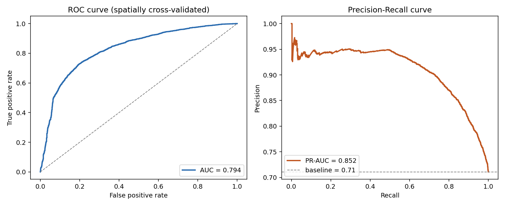
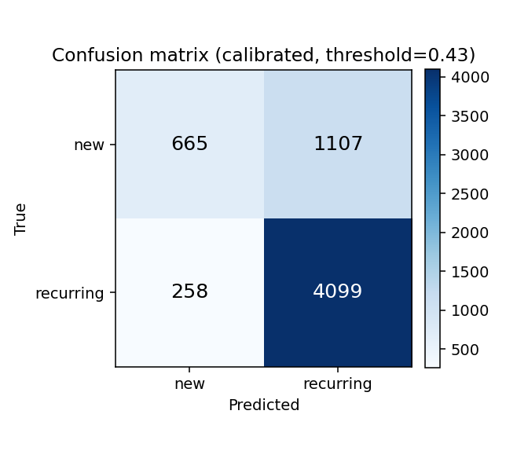
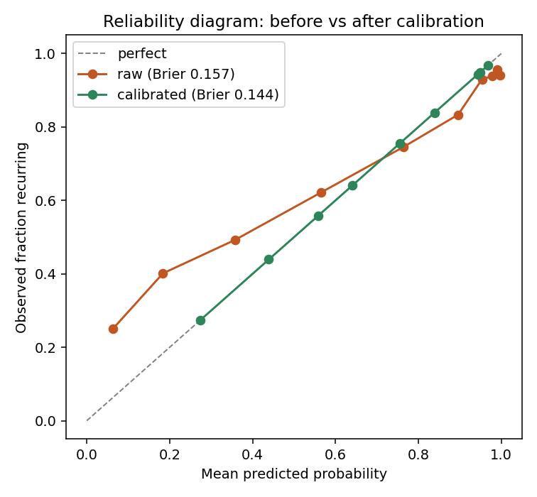
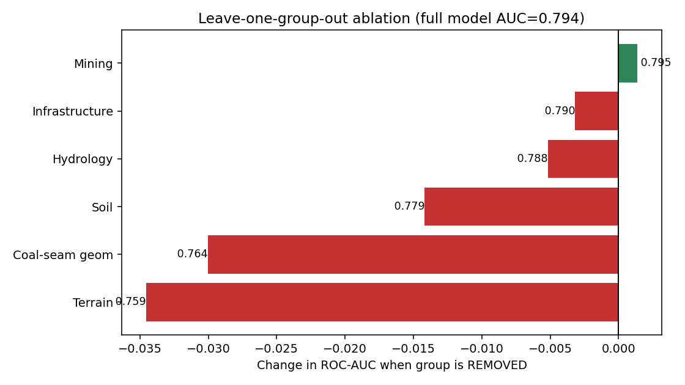
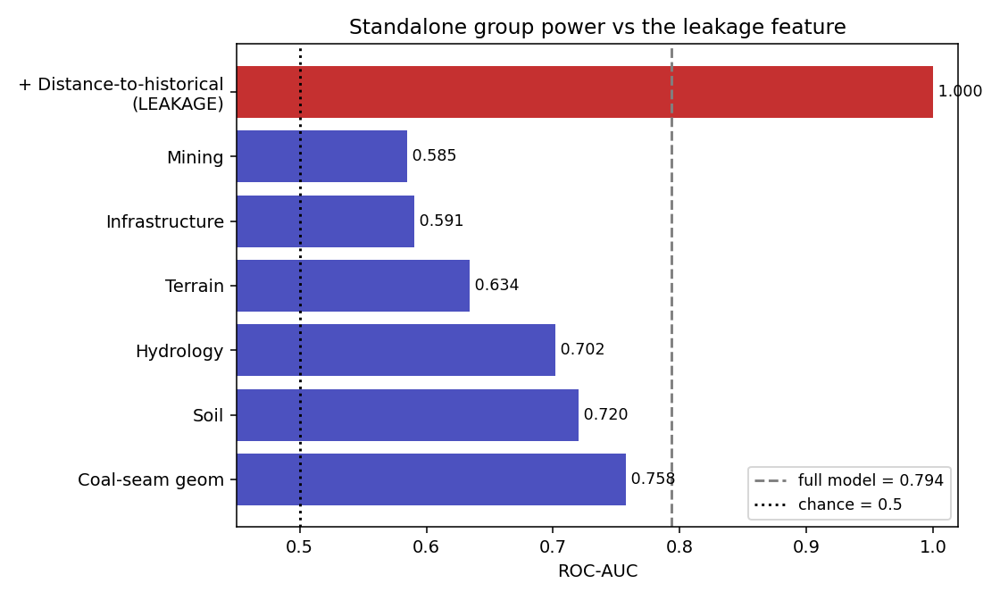
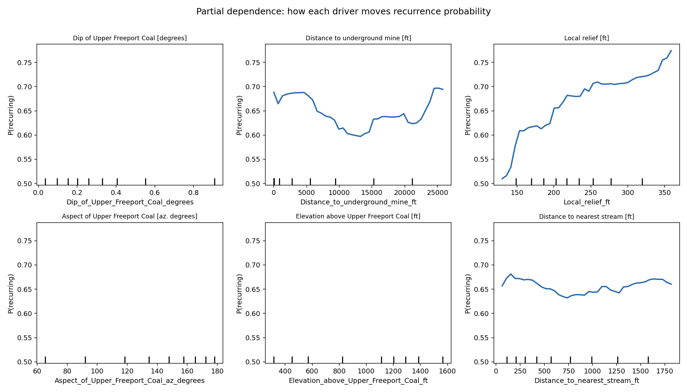
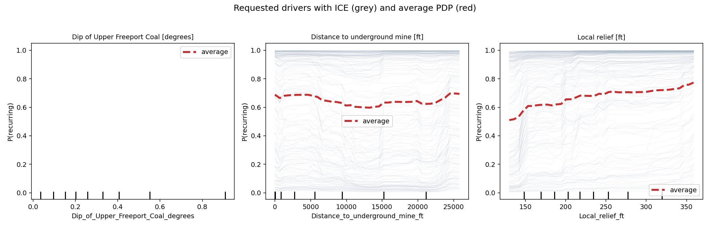

# Predicting Landslide Recurrence in Undermined Southwestern Pennsylvania
### An analysis report with conceptual framework

**Dataset:** `landslides.csv`, 6,129 mapped slide points, 26 columns.
**Task:** classify each location as a **recurring** slide (reactivation of past
failure, label = 1, n = 4,357) versus a **new** slide (first-time failure,
label = 0, n = 1,772).
**Deliverable:** a calibrated, spatially-validated, deployable predictor plus
the diagnostic and explanatory analysis behind it.

---

## 1. Conceptual framework

### 1.1 The scientific question
Landslides in this region are not random. They cluster on hillslopes that have
already failed, and they are strongly conditioned by a century of underground
coal mining that removed support from the overburden. The practical question is:
**given the physical and geologic condition of a slope, is a failure there more
consistent with reactivation of old ground, or with fresh first-time failure?**
Answering it helps target monitoring and stabilization toward the ground most
likely to keep moving.

### 1.2 Susceptibility, not triggering
This is a *susceptibility* model, not a *forecast*. It asks which static ground
conditions (slope, curvature, coal-seam geometry, proximity to mining) are
associated with recurrence. It does not model the triggers (a specific storm,
a freeze-thaw cycle) that determine *when* a slope moves. That separation is
standard in landslide science: susceptibility answers "where / what kind,"
hazard forecasting answers "when."

### 1.3 The three principles that shaped every modeling choice

**(a) Leakage must be removed or the model is meaningless.** A predictor is only
useful if its inputs are genuinely upstream of the outcome. Three columns fail
that test and were excluded:
- `Distance to Historical slides` is the *definition* of the label in disguise.
  A recurring slide sits, by construction, on top of a historical slide (median
  51 ft away, versus 2,325 ft for new slides, with almost no overlap). Including
  it drives cross-validated AUC to a perfect **1.000** while teaching the model
  nothing about ground conditions.
- `Data Source` is a labeling artifact (USGS-sourced points are 81% recurring).
- `Zone` is an administrative/spatial proxy (Zone Charlie is 89% recurring).

**(b) Geography must not leak through the validation split.** Landslide points
are spatially autocorrelated: neighbors share terrain, geology, and mining
history. A random train/test split places a point's near-neighbors on both sides
and reports optimistic accuracy that will not hold at genuinely new locations.
We therefore cluster the points into 12 geographic blocks (by longitude and
latitude) and cross-validate so that whole regions are held out at once. Raw
coordinates are used **only** to build these blocks, never as model features, so
the model cannot memorize location.

**(c) Probabilities must mean what they say.** A deployable risk score should be
calibrated: when the model says 0.7, roughly 70% of such sites should be
recurring. Class-imbalance weighting improves ranking but distorts probability,
so we correct it with isotonic calibration (Section 4).

---

## 2. Methods

| Step | Choice | Why |
|------|--------|-----|
| Model | LightGBM (gradient-boosted trees) | Handles the heavy missingness natively (mine-depth is 71% missing); strong on tabular data; interpretable importance. |
| Imbalance | `scale_pos_weight = neg/pos` | 71/29 class split; weights the minority "new" class. |
| Validation | Stratified group K-fold on 12 spatial blocks | Honest estimate of skill at unseen locations. |
| Threshold | F1-optimal on out-of-fold predictions | Balances precision/recall without peeking at test data. |
| Calibration | Isotonic regression fit on spatial OOF scores | Makes the probability a trustworthy risk value. |
| Features | 19 physical/geologic variables | See Appendix A; leakage columns excluded. |

Reproduce with: `train.py` (model), `ablation_and_plots.py` (ablation +
diagnostics), `calibrate.py` (calibration), `partial_dependence.py` (PDP),
`compare_tabpfn.py` (foundation-model comparison).

---

## 3. Predictive performance

**Spatially cross-validated:** ROC-AUC **0.794 ± 0.093**, PR-AUC **0.852**.
At the deployed threshold, recall is 0.94 on recurring slides and precision 0.79.
Fold-to-fold variance is real and expected: some zones are far more
predictable than others (fold AUC ranges 0.65 to 0.93), which is itself a
finding about spatial heterogeneity.




### 3.1 Foundation-model comparison (TabPFN v2)
TabPFN v2, a pretrained tabular transformer that does in-context learning with no
per-dataset training, was scored on identical spatial folds:

| Metric (spatial CV) | LightGBM | TabPFN v2 |
|---|---|---|
| ROC-AUC | **0.794 ± 0.10** | 0.779 ± 0.12 |
| PR-AUC | **0.852 ± 0.14** | 0.839 ± 0.15 |

With zero tuning the foundation model lands within ~0.015 AUC of the tuned
baseline. LightGBM remains the deployment choice (faster, no GPU/weights
dependency, native importance), with TabPFN as a strong, effortless second
opinion. Large language-model style models are not appropriate for this tabular
task.

---

## 4. Probability calibration

Isotonic calibration, fit on spatial out-of-fold scores, improved the Brier
score from **0.157 to 0.144** (8.4% better) and moved the operating threshold to
a natural **0.43**. The deployed `predict.py` applies this calibrator
automatically, so `recurrence_probability` can be read as an actual risk level.



---

## 5. What drives recurrence (ablation + partial dependence)

### 5.1 Ablation: which feature groups carry the signal
Removing one geologic group at a time from the full model (AUC 0.794):

| Group removed | AUC | Δ | Standalone AUC |
|---|---|---|---|
| Terrain (slope, aspect, curvature, relief) | 0.759 | **-0.035** | 0.634 |
| Coal-seam geometry | 0.764 | **-0.030** | **0.758** |
| Soil (clay, erodibility) | 0.779 | -0.014 | 0.720 |
| Hydrology | 0.788 | -0.005 | 0.702 |
| Infrastructure (road) | 0.790 | -0.003 | 0.591 |
| Mining (distance/depth to mine) | 0.795 | +0.001 | 0.585 |

**Reading it.** Terrain and coal-seam geometry carry the real signal; coal-seam
geometry alone nearly reproduces the full model (0.758). Mining appears
negligible on removal (+0.001) not because it is irrelevant but because its
information is *redundant* with coal-seam and terrain features that encode the
same undermined ground; on its own it still beats chance (0.585). No single group
reaches 0.79, so the skill is genuinely multivariate.




### 5.2 Partial dependence: direction of each driver
Average predicted recurrence probability swept from the 10th to 90th percentile
of each driver (rest held at observed values):

| Driver | Low → High | Effect |
|---|---|---|
| Local relief | 0.578 → 0.721 | **risk UP (+0.142)** with higher relief |
| Elevation above Upper Freeport Coal | 0.654 → 0.772 | **risk UP (+0.118)** with greater elevation above seam |
| Distance to underground mine | 0.688 → 0.623 | **risk DOWN (-0.065)** as you move away from mining |
| Dip of Upper Freeport Coal | 0.678 → 0.658 | mild down (-0.020), non-monotonic |
| Distance to nearest stream | 0.674 → 0.666 | roughly flat marginally |
| Aspect of Upper Freeport Coal | 0.688 → 0.684 | roughly flat marginally |

**Interpretation.** The pattern is physically coherent: recurrence risk is
highest on **high-relief slopes that sit well above the Upper Freeport coal seam
and close to underground mining**. That is exactly the setting where mining
removed support beneath steep, thick overburden, and where old failures reactivate.
Streams and seam aspect matter through interactions (they carry importance) even
though their *marginal* effect is small.




---

## 6. Limitations
- **Label provenance.** The recurring/new label is partly tied to which inventory
  mapped each point. We removed `Data Source` as a feature, but any systematic
  mapping bias in the underlying inventories would still propagate.
- **Missingness.** Mine-depth is 71% missing; LightGBM handles this, but the
  mining signal is correspondingly weak and should not be over-interpreted from
  this dataset alone.
- **Susceptibility, not timing.** No temporal or triggering data, so this cannot
  forecast *when* a slope will move.
- **Spatial transfer.** AUC of ~0.79 is the honest cross-region number; accuracy
  in a completely new county could be lower. Retrain with local points if
  extending beyond the mapped zones.

---

## 7. How to deploy
```bash
python predict.py new_locations.csv -o predictions.csv
```
`new_locations.csv` needs the same physical/geologic headers as `landslides.csv`.
Output adds calibrated `recurrence_probability` and a `recurrence_pred` (0/1) at
threshold 0.43. Treat the probability as a triage score: prioritize field checks
and stabilization on high-relief, high-above-seam, near-mine slopes.

---

## Appendix A. Features used (19)
Slope, wetness index, aspect, distance to nearest stream, mean curvature,
distance to nearest road, hillslope position, drainage area, distance to
underground mine, depth to underground mine, clay content, drainage class,
erodibility factor, saturated hydraulic conductivity, local relief, elevation
above Pittsburgh Coal, elevation above Upper Freeport Coal, aspect of Upper
Freeport Coal, dip of Upper Freeport Coal.

**Excluded (leakage/artifact):** distance to historical slides, data source,
zone number, ID, longitude, latitude.

## Appendix B. Artifacts produced
`landslide_recurrence_model.joblib` (calibrated model), `metrics.json`,
`feature_importance.csv`, `ablation_leave_one_out.csv`,
`ablation_single_group.csv`, `tabpfn_vs_lgbm.csv`, and `plots/` (8 figures).
