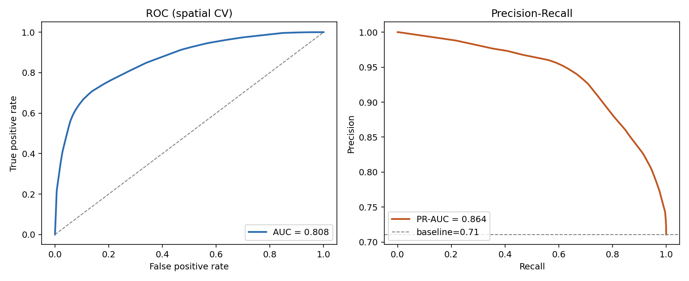
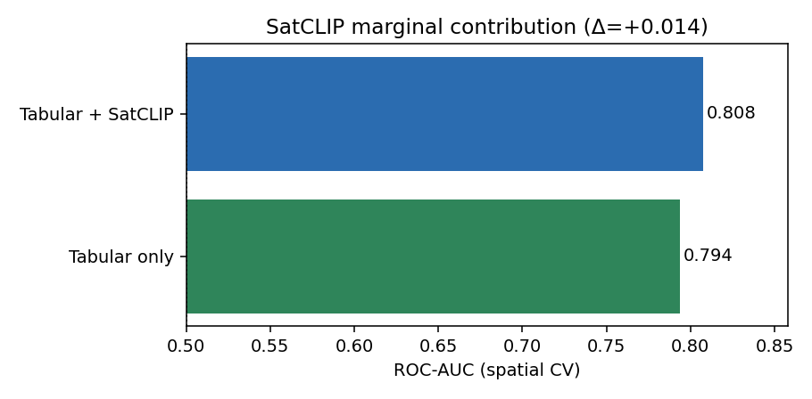
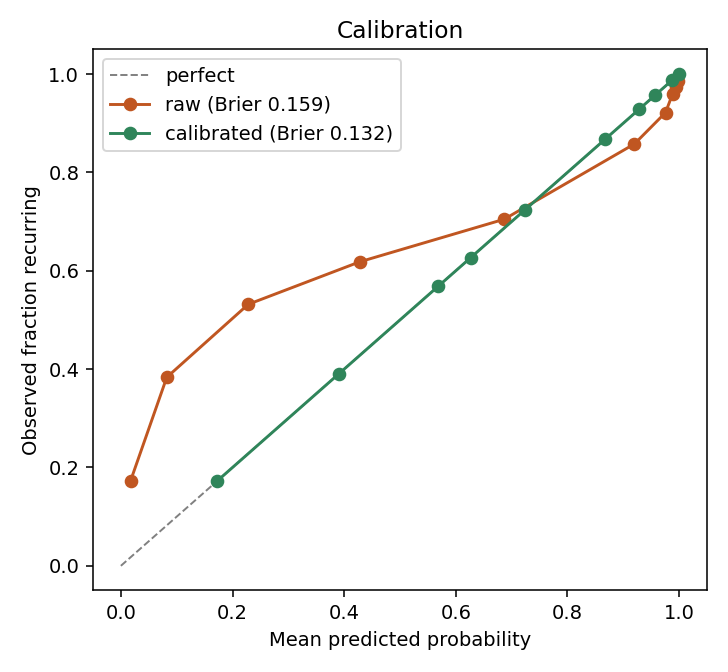
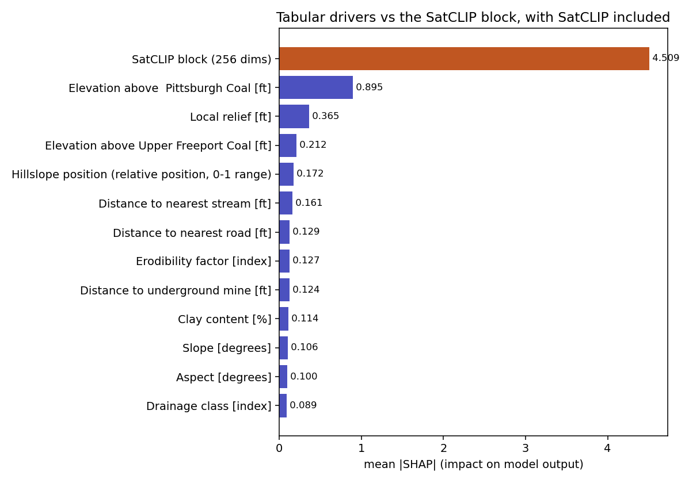
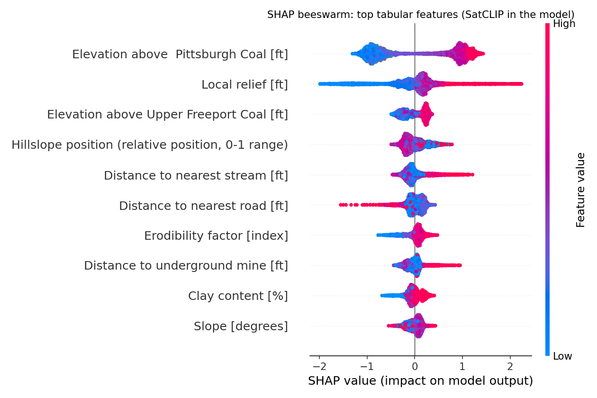
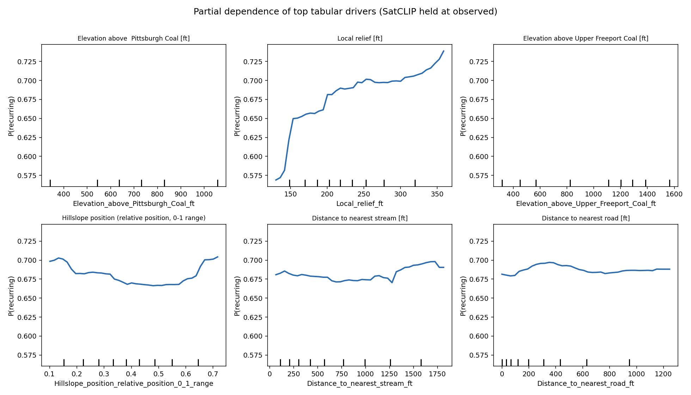

# Tabular + SatCLIP Landslide Recurrence: Analysis Report

**Task.** Classify each mapped slope point as a **recurring** slide (reactivated
old ground, n = 4,357) or a **new** slide (first-time failure, n = 1,772), from
engineered terrain/geologic features fused with SatCLIP geospatial-foundation-
model location embeddings.
**Data.** 6,129 points, southwestern Pennsylvania (undermined coal region).
**Headline.** Spatially cross-validated ROC-AUC **0.808**, and even with 256
SatCLIP dimensions present, the engineered coal-seam and terrain features remain
the dominant single predictors.

---

## 1. Leakage policy (applied before any modeling)
Four columns are dropped in `src/config.py` and never reach the model, plus the
coordinates (used only for SatCLIP and spatial folds):

| Dropped column | Reason |
|---|---|
| `Distance to Historical slides` | Definitional leakage: "recurring" = "on a past slide"; separates classes almost perfectly (AUC → 1.000). |
| `Data Source` | Labeling artifact (USGS points 81% recurring). |
| `Zone` | Administrative / spatial proxy (Zone Charlie 89% recurring). |
| `ID` | Row identifier. |
| `Lon`, `Lat` | Not features; used only for SatCLIP embeddings and spatial CV blocks. |

Model inputs: **19 tabular features + 256 SatCLIP dims = 275**.

---

## 2. Performance (spatial 5-fold cross-validation)

| Model | ROC-AUC | PR-AUC | Brier |
|---|---|---|---|
| Tabular only (19) | 0.794 ± 0.093 | — | — |
| **Tabular + SatCLIP (275)** | **0.808 ± 0.083** | 0.864 | 0.159 → **0.132** |

SatCLIP adds **+0.014 AUC** and clearly improves calibration. At the F1-optimal
threshold (0.40): recall 0.94 on recurring, balanced accuracy 0.69.





Validation uses stratified group K-fold over 12 KMeans spatial blocks, so whole
regions are held out; probabilities are isotonic-calibrated on out-of-fold scores.

---

## 3. Which features dominate once SatCLIP is included (SHAP)

Mean |SHAP| aggregated over all points:

- **SatCLIP block (256 dims): 4.51 total**, but only **~0.018 per dimension**.
- **Tabular block (19): 3.12 total**, led by single features far larger than any
  one location dimension.

| Top tabular feature | mean \|SHAP\| |
|---|---|
| Elevation above Pittsburgh Coal | **0.895** |
| Local relief | 0.365 |
| Elevation above Upper Freeport Coal | 0.212 |
| Hillslope position | 0.172 |
| Distance to nearest stream | 0.161 |
| Distance to nearest road | 0.129 |
| Erodibility factor | 0.127 |
| Distance to underground mine | 0.124 |

**Reading it.** The single strongest predictor in the whole 275-feature model is
a *tabular* one, elevation above the Pittsburgh Coal, at ~50x the average SatCLIP
dimension. SatCLIP's collective impact is large but **diffuse**: it is spread
thinly across 256 location dimensions, consistent with a smooth encoding of
*where* the point is rather than a sharp physical driver.




**Direction of effect** (beeswarm + partial dependence): higher **local relief**,
higher **elevation above the coal seams**, and greater **distance to stream** push
recurrence risk up; **closer to a road** pushes it up. This matches the main
project: recurrence concentrates on high-relief slopes sitting well above the
undermined coal seams.



---

## 4. Honest caveat on SatCLIP
SatCLIP is a **global location encoder**: its embedding is a smooth function of
(lon, lat). Across this ~100 km study area it largely re-encodes spatial position,
which the tabular model deliberately excludes (coordinates dropped) to avoid
spatial memorization. The +0.014 AUC and better calibration are real, but should
be read as **residual spatial/environmental context, not a new physical driver**.
The SHAP picture supports this: SatCLIP helps a little, broadly, while the
physics stays in the engineered terrain and coal-seam features.

---

## 5. Reproduce
```bash
cd src
python train.py            # model, metrics, calibration, core plots
python shap_analysis.py    # SHAP + partial-dependence plots
python predict.py new_sites.csv -o outputs/predictions.csv
```
`new_sites.csv` needs the tabular headers plus `Lon (Degree)` / `Lat (Degree)`.
Output adds calibrated `recurrence_probability` and `recurrence_pred`.

## Limitations
Mine-depth is 71% missing (mining signal is thin); the label may carry inventory
bias; this is a susceptibility model, not a temporal forecast; AUC ≈ 0.81 is the
honest cross-region number and could be lower in an entirely new county.
